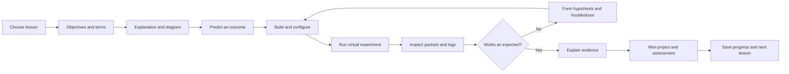
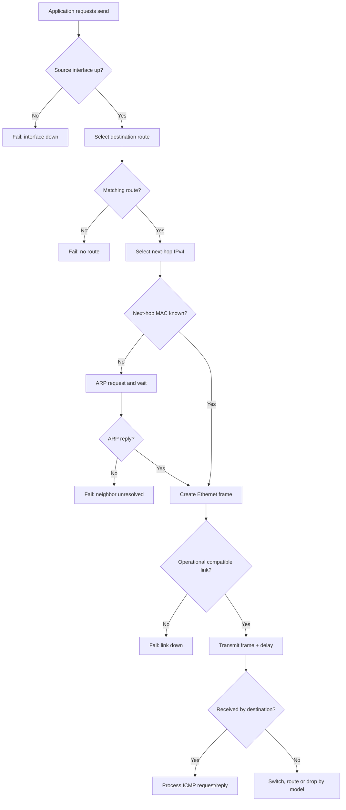
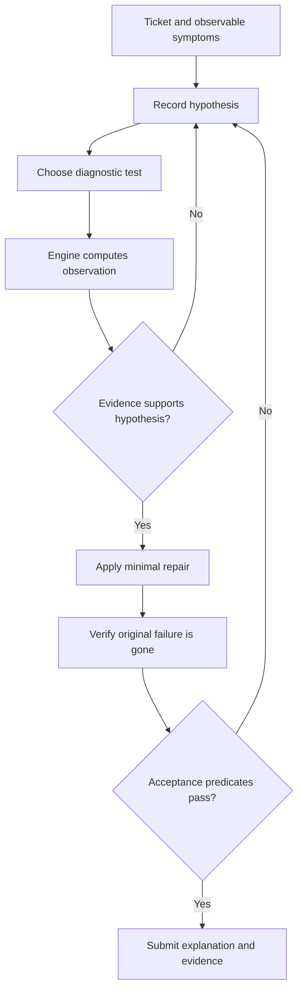
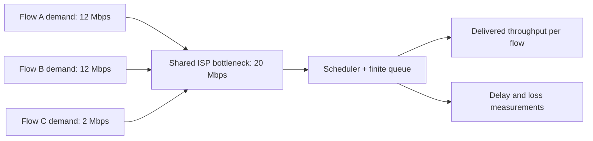

# NETVERSE LAB — Master Product, Learning and Simulation Design

**Document ID:** NV-DESIGN-001  
**Version:** 1.0.0 (implementation baseline)  
**Date:** 2026-10-27  
**Status:** Design delivered; Phase 0 environment preparation is next  
**Project type:** Offline-first, interactive networking education and simulation web application  
**Audience:** Complete beginners through intermediate networking and cybersecurity learners  
**Primary hardware target:** Ubuntu on Lenovo ThinkPad X280, 8 GB RAM; Windows and Android as secondary clients  
**Implementation language:** TypeScript/JavaScript  
**Development policy:** Build, test, and accept one vertical learning slice before expanding scope.

> **Definition of success:** A learner can study a networking concept, build a network, configure its devices, test it with virtual commands, observe and explain its packet behavior, deliberately introduce a fault, diagnose the fault using evidence, repair it, and prove that communication has recovered. The stateful network model—not animation or a checklist—determines outcomes.

---

## 1. Product purpose, scope and boundaries

### 1.1 Problem

Students often memorize terms such as DHCP, NAT, switching, latency, routing and DNS without obtaining hands-on competence. Physical networking equipment is expensive; professional emulators can be difficult for beginners; simplified diagrams often misrepresent actual behavior. NETVERSE LAB unifies instruction, a network workbench and evidence-driven incident resolution.

### 1.2 Value proposition

NETVERSE combines: (a) nine-step lessons; (b) a configurable topology canvas; (c) a deterministic, observable protocol simulation; (d) a virtual diagnostic console; (e) guided and unassisted incident scenarios; (f) network-performance experiments; and (g) an eventual physical-Internet explorer and opt-in isolated Linux laboratory.

### 1.3 Non-goals for initial versions

- Not a Cisco IOS replacement or complete reproduction of real router firmware.
- Not a full RF, electrical, electromagnetic, optical, or TCP-kernel simulator.
- Not a live ISP monitoring system; scenario data is synthetic unless explicitly imported.
- No real network scanning, packet injection, or external Internet traffic originating from the *simulation* engine.
- No accounts, social system, payment processing, large backend, AI grading, mandatory 3D or cloud dependency in the MVP.
- No claim that simplified virtual command outputs exactly reproduce Linux in every edge case.

### 1.4 Core principles

1. **Model truth, not cinematic truth.** The engine makes packet-delivery decisions; UI consumes its event log.
2. **One authoritative state.** Topology, configuration, routing, service and packet behavior derive from the engine state; avoid independent UI-only connectivity flags.
3. **Deterministic replay.** Given the scenario seed, configuration, ordered actions, and engine version, results must be reproducible.
4. **Realistic simplification.** State where abstractions differ from real networking.
5. **Explore freely.** Guided lessons and open-ended valid solutions use the same engine.
6. **Explain causality.** Learners can distinguish link-down, missing ARP response, routing failure, protocol filtering, service unavailability and DNS failure.
7. **Offline-first.** Core lessons, saved topologies and exercises work without Internet after installation.
8. **Accessible without drag.** Network elements and links can be added using forms and keyboard as well as drag-and-drop.
9. **Save safely.** Version all persisted data; offer export/import and preserve existing projects through migrations.
10. **Evidence-based grades.** Multiple valid diagnosis strategies can receive full credit.

### 1.5 Learner personas

- **Beginner:** Knows how to use a computer; needs definitions, objects analogy, labelled diagrams, guidance and feedback.
- **Student developer:** Knows basic programming and wants networking context for HTTP, Node.js, servers and troubleshooting.
- **Cybersecurity trainee:** Wants incident investigation, packet inspection, network segmentation, access control and safe experiments.
- **Instructor (later):** Needs scenario authoring, reproducible assessments and guided practice.

---

## 2. Learning design and content contract

### 2.1 Mandatory nine-step lesson format

Every complete lesson contains all nine stages:

1. **Topic & objectives:** competency-based, observable outcomes.
2. **Definitions:** correct, concise glossary and prerequisites.
3. **Step-by-step explanation:** causally ordered processes and checkpoints.
4. **Illustrations/diagrams:** topology, flowchart or physical-connection image, with text alternative.
5. **Commands/code/examples:** executable virtual lab demonstrations; realistic output and failure branches.
6. **Real-world application:** scenario from home, apartment, office, campus, ISP or security operations.
7. **Exercises:** prediction, explanation and hands-on configuration; actionable feedback.
8. **Lesson mini-project:** a functioning deliverable with validation tests.
9. **Integrated main project:** an incremental contribution to the learner's growing network system.

Lesson phases can be revisited nonlinearly, but the learner cannot receive 'practical competence' merely for clicking through text.

### 2.2 Content model

`Course -> Module -> Lesson -> Step -> Content blocks -> Exercises -> Mini-project -> Competency evidence`.

Required metadata for a lesson: `id`, `version`, `moduleId`, `title`, `objectives[]`, `prerequisites[]`, `glossary[]`, `steps[1..9]`, `linkedScenarioIds[]`, `assessmentIds[]`, `estimatedSessionMinutes`, `fidelityNotes[]`.

Content blocks: paragraph, labelled illustration, analogy, flowchart, formula, command transcript, interactive device object, predict-then-run prompt, multiple choice, short explanation and embedded lab. Avoid prescribing answers in student-facing troubleshooting statements.

### 2.3 Analogy system

Analogies aid understanding but include a **Where the analogy breaks** note:

| Concept | Everyday object analogy | Limitation / correction |
|---|---|---|
| IP address | Street address | IP addresses belong to logical interfaces and routes, not permanently to people or machines. |
| MAC address | Label on a local delivery bin | MAC addresses are interface identifiers, not globally authenticated identities. |
| Switch | Building receptionist delivering within one building | Real switches learn source MAC addresses and forward Ethernet frames by forwarding table and VLAN. |
| Router | Junction that selects onward roads | Routing is longest-prefix matching and forwarding-policy dependent, not geography. |
| DNS | Phone directory | DNS is hierarchical, cached and distributed, not a single directory. |
| Packet | Addressed parcel | Networks may fragment, drop, reorder and retransmit at different layers. |
| Bandwidth | Width of a road | Throughput depends on protocol overhead, congestion, demand and link quality. |
| Latency | Travel time | RTT includes propagation, transmission, processing, queueing and return path. |
| Fibre | Flashlight carrying coded information | Real optical links use transceivers, modulation, multiplexing and optical budgets. |
| NAT | Apartment mailroom translating unit addresses | NAT is stateful address/port translation, not encryption or anonymity. |

### 2.4 Curriculum mapping (14 modules)

| Module | Knowledge and demonstrations | Mini-project or experiment | Integrated contribution |
|---|---|---|---|
| 01 — Foundations | Devices, endpoints, packets, LAN/WAN, client/server | Two-machine communication | Two-PC network |
| 02 — Hardware & physical links | NICs, copper, Ethernet connectors, fibre, optics, ONT/OLT, switches, routers, masts | Select and cable hardware correctly | Documented physical topology |
| 03 — OSI & TCP/IP | Encapsulation, decapsulation, frame vs packet vs segment | Packet X-ray | Layered observation |
| 04 — Ethernet & Wi-Fi | MAC learning, ARP introduction, broadcast, wireless association | Switch-based classroom LAN | LAN growth |
| 05 — IPv4/IPv6 & subnetting | Prefixes, gateways, CIDR, host/network, IPv6 notation | Design address plan | Multi-subnet address plan |
| 06 — Switching & routing | MAC tables, longest-prefix routes, next hops | Route between two LANs | Router backbone |
| 07 — DHCP/DNS/NAT & services | DHCP lease, DNS query, NAT, ICMP | Configure DHCP and name service | Functional client Internet model |
| 08 — TCP/UDP & ports | Ports, socket basics, handshake, retransmission (abstracted) | Compare TCP vs UDP flows | Application endpoints |
| 09 — Internet infrastructure | Access, ISP, fibre, mobile towers, backhaul, peering, exchange, submarine cables, CDN | Trace journey to hosted service | Multi-ISP map |
| 10 — Performance | bits/bytes, goodput, RTT, loss, jitter, queues, Wi-Fi contention, link bottlenecks | Congestion experiment | Capacity plan |
| 11 — Administration | CLI, route reading, link status, logging, packet captures | Diagnose an apartment outage | Operating playbook |
| 12 — Security & privacy | Firewalls, VLAN isolation, TLS, VPN/proxy limitations, threat modeling | Secure a small office | Segmented secure network |
| 13 — Advanced networking | VLANs, virtual switches, cloud concepts, SDN, IPv6 routing | Virtual enterprise lab | Branch-office network |
| 14 — Capstone | Design, build, fault injection, troubleshooting, documentation | End-to-end simulated campus/ISP incident | Final assessed network portfolio |

**Content rule:** all required course modules will eventually be covered, but the initial release ships only the first complete vertical lesson and its related lab.

### 2.5 Session design

Default lesson cadence: 30 minutes (5 min review, 10 min theory/illustration, 10 min experiment, 5 min reflection). Sessions are resumable at any step. No streak mechanics that pressure learners to rush. Optional skill check lets experienced students demonstrate prerequisites and skip explanations, not required safety/verification steps.

---

## 3. User experience and navigation

### 3.1 Main areas

- **Dashboard:** continue, competence summary, lab state, recent incidents.
- **Learn:** module map, nine-step lesson view, glossary, diagrams and checks.
- **Build:** topology designer, device palette, inspector, port/cable picker, run/step controls.
- **Troubleshoot:** ticket, evidence notebook, tools, diagnoses, repair verification.
- **Explore:** physical infrastructure models and routes (deferred).
- **Challenge:** minimal assistance and assessment rubric (deferred).
- **Projects:** save, duplicate, import/export, examples, version migrations.
- **Settings:** performance mode, accessibility, sound, reduced motion, unit display, simulation speed.

### 3.2 Detailed workbench regions

Desktop layout: left palette (devices/cables), center topology canvas, right selected-device properties, bottom collapsible terminal + packet/event log. Mobile layout: canvas first, device palette/inspector/terminal in accessible tabs or drawers. Touch selection must not require hover. Reposition by controls when drag is unavailable.

### 3.3 Common user journeys

**First launch:** onboarding -> diagnostic knowledge check (optional) -> lesson 01 -> guided build -> run ping -> break link -> explain failure -> repair -> save.

**Troubleshooting:** ticket -> inspect topology and symptoms -> propose hypothesis -> run virtual diagnostic -> record evidence -> make controlled configuration change -> verify -> submit incident report -> debrief.

**Free-build:** open workbench -> choose devices -> connect interfaces -> configure network -> test -> inspect -> save/export.

**Open previous project:** load -> validate data version -> migrate if needed -> restore topology and config -> start in paused state -> show saved notes.

### 3.4 User feedback taxonomy

Every interaction returns one of: `SUCCESS`, `INVALID_INPUT`, `INCOMPATIBLE_INTERFACE`, `CONFIGURATION_CONFLICT`, `NO_ROUTE`, `NEIGHBOR_UNRESOLVED`, `LINK_DOWN`, `FILTER_DENIED`, `SERVICE_UNAVAILABLE`, `SIMULATION_LIMIT`, `NOT_IMPLEMENTED`. Error text explains affected object and suggests a diagnostic next action without leaking hidden fault in independent mode.

---

## 4. Simulation architecture

### 4.1 Hard separation of concerns

```text
React UI / XYFlow Canvas / Lesson renderer / Virtual console
                          |
                   command & action API
                          v
                 Simulation controller
         scenario seed / clock / scheduler / validation
                          |
                   ENGINE (headless)
 devices -> interfaces -> links -> switching -> IPv4/ARP
                     routing -> services
                          |
            immutable observable event stream
                          v
 packet inspector / command output / graphs / grading
```

Neither visualization nor assessment may mutate authoritative engine state directly. They dispatch actions through validated commands, and render the resulting state and events.

### 4.2 Discrete-event execution

Use a priority queue keyed by `(simulationTimeMs, sequenceNumber)`; monotonically increasing sequence numbers break ties deterministically. Event categories: link-up/down, frame enqueue/transmit/arrive, ARP timeout, address configuration, packet forward/drop, DHCP exchange (later), TCP timer (later), service response, queue-drop, and measurement sample. Cap events/second, queue sizes and graph complexity. Simulation time is independent of browser wall time. Pausing stops event advancement; step advances one atomic event; replay uses seed + action log + engine version.

### 4.3 Engine invariants

- Nodes and interfaces have globally unique IDs within a project.
- Each physical point-to-point interface supports at most one direct cable unless explicitly modeled as a shared medium.
- A frame can traverse an operational link only when both ends are operational and media compatible.
- A host does not send a packet directly to a nonlocal destination's MAC; it resolves the next-hop MAC, except for explicit on-link routes.
- Directly attached routes derive from active interfaces (later configurable kernel-like behavior is documented).
- Route selection uses most-specific prefix, then metric/tie-break rules.
- Routers decrement IPv4 TTL when forwarding and discard at zero, generating suitable ICMP where modeled.
- Ethernet switches learn source MAC per VLAN, forward known unicast, and flood unknown unicast/broadcast within a broadcast domain; loop protection is deferred.
- IP and MAC address uniqueness is not globally assumed; duplicates can cause a conflict scenario.
- Traces never show a successful reply for a nonexistent destination.
- DNS resolution and Internet IP reachability are independent.
- ICMP response failure is **not conclusive proof** that all transport protocols fail.
- NAT is applied only where configured and required by scenario; routing can work without NAT when return routes exist.
- The engine never automatically repairs an invalid configuration because a learner completed a lesson step.

### 4.4 Fidelity layers

**F0 — Teaching concepts:** accurate state-based reachability, logical devices, links, routes, simple timing.

**F1 — Protocol behavior:** Ethernet learning/flooding, ARP, ICMP, IPv4 forwarding, DHCP, DNS, stateful NAT, simplified TCP/UDP; label approximations.

**F2 — Performance:** link serialization, propagation, finite queues, congestion, wireless contention approximations, service demand and time series.

**F3 — Real isolation (later):** opt-in Linux namespaces/containers with permissions, sandbox constraints and clear warning that packets may be real inside local environment.

### 4.5 Engine and rendering performance

Keep engine independent from React renders; for scale, place event simulation in a Web Worker once profiling shows need. Stream summary updates at UI-friendly rates rather than rerendering every packet event. Default cap for first playable lab: 12 nodes, 24 interfaces, 24 links, 200 stored packet events and 100 events per simulated second. These are proposed MVP guardrails, not hardware-network limitations. Expand only after measured performance tests on 8 GB laptop and midrange Android phone.

---

## 5. Data contracts (TypeScript-level specification)

These are **reference interface definitions** to guide implementation; they are not application code and may be refined only through documented design changes.

```ts
type NodeId = string;
type InterfaceId = string;
type LinkId = string;
type PacketId = string;
type TimestampMs = number;

type DeviceKind =
  | 'host' | 'router' | 'switch' | 'server'
  | 'access_point' | 'ont' | 'olt' | 'cell_site' | 'isp_gateway';

type Medium = 'ethernet_copper' | 'fibre' | 'wifi' | 'virtual';
type Duplex = 'full' | 'half' | 'not_applicable';

type InterfaceState = {
  id: InterfaceId;
  deviceId: NodeId;
  name: string;
  medium: Medium;
  macAddress?: string;
  adminUp: boolean;
  operUp: boolean; // derived from admin, hardware and link states
  ipv4?: { address: string; prefixLength: number; method: 'static' | 'dhcp' };
  mtuBytes: number;
  negotiatedSpeedBps?: number;
  duplex?: Duplex;
};

type DeviceState = {
  id: NodeId;
  kind: DeviceKind;
  displayName: string;
  position: { x: number; y: number }; // presentation only
  poweredOn: boolean;
  interfaceIds: InterfaceId[];
  config: Record<string, unknown>; // later discriminated by kind
};

type PhysicalLink = {
  id: LinkId;
  endpointA: InterfaceId;
  endpointB: InterfaceId;
  medium: Medium;
  capacityBps: number;
  propagationDelayMs: number;
  errorRate: number; // probability 0..1, seeded
  enabled: boolean;
};

type Ipv4Route = {
  network: string;
  prefixLength: number;
  nextHop?: string;
  exitInterfaceId: InterfaceId;
  metric: number;
};

type PacketEvent = {
  id: string;
  simulationTimeMs: TimestampMs;
  category: 'created' | 'enqueued' | 'transmitted' | 'received'
    | 'forwarded' | 'delivered' | 'dropped' | 'timeout';
  deviceId?: NodeId;
  interfaceId?: InterfaceId;
  packetId?: PacketId;
  reasonCode?: string;
  details: Record<string, unknown>;
};

type NetworkProject = {
  schemaVersion: number;
  engineVersion: string;
  projectId: string;
  displayName: string;
  seed: number;
  devices: DeviceState[];
  interfaces: InterfaceState[];
  links: PhysicalLink[];
  routes: Record<NodeId, Ipv4Route[]>;
  lessonProgress?: Record<string, unknown>;
  notes?: string;
};
```

**Design note:** replace `Record<string, unknown>` with device-specific discriminated configuration types before Phase 4; avoid making arbitrary UI objects the protocol implementation. Prefer a canonical valid IPv4 representation internally (32-bit integer) rather than relying on string equality. UI positions must not influence network reachability.

### 5.1 Action API

```
addDevice / removeDevice / renameDevice
connectInterfaces / disconnectLink
setInterfaceAdminState / setIpv4Address / clearIpv4Address
addStaticRoute / removeStaticRoute
start / pause / step / reset / replay
sendIcmpEcho / issueVirtualCommand / injectFault
saveProject / loadProject / exportProject / importProject
```

Every action validates input; returns a typed result and optionally emits state events. Invalid actions must not partially modify state. Actions that modify topology while running should be serialized and logged.

### 5.2 IP and link data correctness

- IPv4 parsing enforces four decimal octets each 0–255 and prefix length 0–32.
- Host route versus subnet route interpretation is explicit.
- Subnet membership uses prefix masking, not a text-prefix comparison.
- Prevent impossible cable media pairings; allow configurable adapters/transceivers only when modeled.
- Optional simulation-specific safety limits (e.g., max links) yield clear errors.
- ARP entries hold IP, MAC, interface, expiry and reachability state in defined scopes.
- ICMP output includes errors and loss counts; times derive from simulation metrics.

---

## 6. Packet path semantics: first milestones

### 6.1 First successful same-subnet ping

Topology: PC-A `192.168.1.10/24` <-> copper Ethernet <-> PC-B `192.168.1.20/24`.

1. Learner types `ping -c 3 192.168.1.20` on PC-A virtual console.
2. Virtual terminal parser validates syntax and creates a `PING_REQUEST` engine action.
3. PC-A consults its routes; detects destination on local prefix.
4. On ARP cache miss, PC-A broadcasts an ARP request; the frame travels on the active link.
5. PC-B sends ARP reply; PC-A learns its MAC (optional reciprocal learning depending on implementation).
6. PC-A creates ICMP Echo Request inside IPv4 packet inside Ethernet frame addressed to PC-B MAC.
7. Link transmits frame with finite simulated delay; PC-B processes ICMP and sends an Echo Reply.
8. PC-A receives reply; terminal emits RTT measurement and summary; inspector logs each modeled event.

No fabricated “success” is permitted: if PC-B is unpowered, link down or destination mismatched, events must reflect the corresponding failure.

### 6.2 First failure cases

- **Cable disconnected:** interfaces down, no frame delivery, ping timeout or local network error as modeled.
- **Different `/24` prefixes without route:** PC-A lacks valid next hop; unreachable diagnostic, not magic routing.
- **Interface admin down:** no packet emission on that port.
- **Nonexistent destination in same subnet:** ARP unanswered, then neighbor-resolution failure and ping loss.
- **Host firewall denies ICMP reply (later):** route may be valid but no Echo Reply; ICMP filtering visible only through authorized observability.

### 6.3 Switching milestone

A three-host switched network must demonstrate: source MAC learning, ARP broadcast propagation, known-unicast frame forwarding, unknown-unicast flooding and MAC aging with per-port table inspection. No STP or bridging loops in initial milestones; looping topologies either rejected or gated with explanation until STP is modeled.

### 6.4 Routing milestone

Two `/24` networks linked by a router: traffic succeeds only if hosts have appropriate routes/default gateways and router is configured correctly. Replies must have return paths. TTL decreases at router; routing loop expires by TTL once loops are supported. Distinguish routing table from ARP/neighbor table.

### 6.5 DHCP/DNS/NAT milestone

- DHCP represents discover/offer/request/ack with lease ownership and expiration; no instant global arbitrary assignment.
- DNS represents a query and reply against a scenario-owned authoritative data set/cache; unknown names yield appropriate failure.
- NAT maintains explicit mappings and provides return traffic translation; does not create Internet connectivity by itself.
- Simulated ISP gateway exposes controllable network access and routing policy rather than assuming WAN DHCP implies Internet access.

---

## 7. Virtual terminal design

### 7.1 Command parser

Allow-list commands only; tokenize safely with quoted arguments; no `eval`, shell execution, OS access or arbitrary file operations. Commands operate against selected device context, not the user's real laptop.

### 7.2 Command progression

| Milestone | Commands | Model dependence |
|---|---|---|
| v0.1 | `help`, `ip addr`, `ip link`, `ip route`, `ping -c N`, `clear` | interfaces, routes, ICMP reachability |
| v0.2 | `ip neigh`, `arp -a`, `traceroute` | ARP table, hop model |
| v0.3 | `nslookup`, `dig`, `curl`, `dhclient` (simulated) | DNS, HTTP endpoint, DHCP |
| v0.4+ | `ss`, `tcpdump`-like viewer, `ping -6` | transport state, capture events, IPv6 |

Support common meaningful syntax variations but respond honestly with **Command not supported in this simulation** for unsupported options. Do not imply actual Ubuntu execution.

### 7.3 Error messages

Distinguish three classes: syntax error (bad flags/arguments), valid command with network failure (timeout/unreachable), and simulation limitation (feature unsupported). The console transcript persists with an incident only if chosen by learner; sensitive real credentials should never be required.

### 7.4 Three-level reveal

- **Guided:** explanatory event reasons visible, command hints recommended.
- **Assisted:** basic network symptom and optional hints; deeper engine diagnostics by explicit request.
- **Independent:** hide root-cause event tags and intended fix until submission; retain realistic accessible observations and logs.

---

## 8. Network performance and Internet-speed laboratory

### 8.1 Definitions and metrics

- **Link rate / nominal bandwidth:** maximum nominal signaling or traffic bit rate as modeled.
- **Throughput:** bits of delivered data per measured time period.
- **Goodput:** application payload delivered per time period, excluding retransmissions and protocol overhead.
- **Latency:** time required for delivery; `ping` generally reports RTT.
- **Jitter:** variation in packet delay; define exact estimator in UI.
- **Packet loss:** packets unsuccessfully delivered relative to attempted transmissions.
- **Congestion:** offered load temporarily or persistently exceeds service capacity, causing queueing and drops.
- **Fairness:** allocation dependent on application demand, transport behavior and scheduling policy.

### 8.2 Link model

For an illustrative full-duplex link:

`serialization_delay_seconds = packet_bits / link_capacity_bits_per_second`

`one_way_delay ≈ serialization + propagation + queue_wait + processing`

Approximate bottleneck capacity is the minimum effective rate on a path; actual application throughput may be lower. Queue stores packets up to a configured byte/packet limit; arrivals when full may drop (tail-drop in first version). Preserve directional counters. Define whether link values represent physical raw rate or modeled IP-layer payload capacity.

### 8.3 Multiple-device scenario

For a shared 20 Mbps *modeled usable bottleneck* and three saturated flows with a **specified equal-fair-share approximation**, output is about 6.67 Mbps/flow before any separate overhead. This is **not** a universal per-device speed guarantee. Idle clients do not necessarily reduce others' speeds. Introduce examples of 1 high-demand download + 2 light-demand clients; 3 saturating clients; bufferbloat; mobile radio bottleneck; Wi-Fi signal degradation; wired uplink bottleneck; and ISP shaping.

### 8.4 Interactive controls

ISP bottleneck Mbps, per-device demand Mbps, number of active flows, link capacity, propagation delay, finite queue depth, simulated interference/error rate, scheduling policy (equal-fair-share *approximation* initially), and experiment duration. Outputs: per-flow throughput, total throughput, RTT, queue delay, drops, utilization and explanatory bottleneck highlighting. Pause, compare baseline, reset seed and export result summary.

### 8.5 Worked calculations

- 20 Mbps / 8 = 2.5 MB/s **theoretical decimal bytes per second**, before protocol overhead.
- 100 MB at 2.5 MB/s = 40 seconds ideal transfer; practical transfer takes longer when overhead or contention exists.
- 1,500-byte frame/payload boundary discussions must state header, MTU and payload assumptions; avoid mixing these silently.
- Compare nominal Wi-Fi PHY link rates to end-to-end throughput: they are different metrics.

---

## 9. Physical-Internet and infrastructure explorer (later phases)

### 9.1 Objects and relationships

Copper NIC -> RJ45 jack and twisted pair -> switch/router; fibre transceiver/SFP -> fibre connector -> patch panel/termination box -> splitter (PON context) -> OLT -> ISP network; ONT converts optical access link to customer Ethernet. Cellular path: phone radio -> cell sector/antenna -> radio access equipment -> backhaul (microwave or fibre) -> mobile core -> ISP/Internet; a visible mast supports antennas and hardware but is not itself the protocol gateway. Internet path may traverse access ISPs, peering/IXP, transit, CDN or data centers and possibly submarine cable landing stations; not every flow takes every component.

### 9.2 Physical interactions

Select an object -> identify name/function/connectors/media/typical failure. Toggle link failure -> see affected services. Follow packet journey -> annotate medium and protocol changes. Use layer reveal (physical, link, IP, application) rather than mixing them in a single cartoon. Ensure logical topology is not misrepresented as a geographically exact map.

### 9.3 Fidelity disclaimer

Optical light pulses, radio waves and submarine routes are illustrative animations, not electromagnetic physics or certified engineering models. Where distance/capacity is shown, define source or label schematic.

---

## 10. Scenario and incident system

### 10.1 Scenario data schema

```json
{
  "scenarioId": "apt-wan-001",
  "version": 1,
  "title": "Apartment Internet Outage",
  "difficulty": "assisted",
  "initialProjectId": "apartment-topology-base",
  "randomSeed": 47211,
  "publicTicket": "Wi-Fi connects, but Internet access fails; nearby apartments work.",
  "hiddenFaults": [{"type":"upstream_acl_denies_wan_mac","targetId":"isp-gateway-1"}],
  "availableTools": ["terminal","wan_status","topology","event_log"],
  "objectives": [
    {"id":"diagnose","evidence":"valid_root_cause_with_support"},
    {"id":"repair","evidence":"wan_access_restored"},
    {"id":"verify","evidence":"successful_http_and_dns"}
  ],
  "acceptedRepairTypes": ["authorized_register_wan_mac"],
  "hintLevels": ["addressing","gateway","upstream_policy"]
}
```

The hidden fault configuration is not exposed in student-visible runtime objects in independent mode; scenario loader separates private evaluator data from observable state. Avoid relying on visual obscurity or CSS-only hiding.

### 10.2 Evidence notebook

Fields: timestamp, hypothesis, test selected, observed result, interpretation, configuration change, verification outcome. Can be automatically populated from simulated events and annotated by learner. Learner submits an incident report containing symptoms, cause, evidence, repair, verification and remaining uncertainty.

### 10.3 Grading

Use objective predicates applied to engine state and evidence trail, not a required click order. Proposed 100-point rubric: addressing 15, routing 15, local-vs-upstream distinction 20, root cause 20, repair 20, verification 10. Do not reward random configuration changes merely because a network reconnects. Independent mode may penalize unnecessary disruptive changes (optional, disclosed). Accept any semantically equivalent repair when engine supports it.

### 10.4 Scenario families

1. Two PCs, one link, bad addressing.
2. Classroom LAN, missing physical connection.
3. Incorrect default gateway.
4. Router receives WAN DHCP address but upstream restricts Internet.
5. Public IP reachable, DNS fails.
6. Local network fine, bottleneck saturates in evening.
7. DHCP server unavailable or pool exhausted.
8. VLAN mismatch with intended security segmentation.
9. Fibre endpoint or access link down.
10. Cellular backhaul congestion (abstracted).
11. Office firewall blocks needed application port.
12. Suspicious DNS patterns and defensive investigation.

---

## 11. Persistence, interoperability and offline policy

### 11.1 Local-first storage

Use IndexedDB for saved topology, lesson progress, logs and local learning preferences. Maintain a schema version, deterministic import/export JSON with integrity validation, duplicate-safe IDs and migration procedures. Save the authoritative configuration, not transient cached calculations as ground truth. Preserve an action replay log where manageable. Always allow user-triggered export, import, duplicate, delete with confirmation and backup suggestions.

### 11.2 Offline capability

Vite's development server is not the offline experience. Add an appropriate service worker/PWA packaging phase **after** core functionality is stable. Offline means no network calls are required after assets are cached/installed; initial dependency installation still needs connectivity. Browser-storage eviction remains possible, so JSON export is essential.

### 11.3 Privacy and safety

No capture of real Wi-Fi passwords. The simulator is not permitted to run shell commands on the host, access real routers, or scan neighbors. Real-network mode (future) requires explicit consent and separate architecture. Do not store personally identifying device details when unnecessary. Add clear banners for 'Virtual Network' versus 'Real Linux Lab'. Avoid using actual apartment tenant identities and secrets in sample tickets.

---

## 12. Stack and dependency policy

### 12.1 Initial

- **React + TypeScript + Vite:** frontend foundation.
- **Native CSS** for first stages; Tailwind optional when UI complexity merits it.
- **Vitest** for unit and engine tests.
- **ESLint + TypeScript compiler** for static checks.
- **@xyflow/react** for canvas **in Phase 3**, not Phase 0.
- **IndexedDB** through a small repository interface; prefer no dependency initially.

### 12.2 Deferred until needed

- Three.js: physical explorer phase.
- xterm.js: full terminal presentation; parser remains headless and custom.
- Zustand: if React state orchestration becomes complex.
- Chart library: when performance graphs exist.
- Playwright: browser acceptance tests once core screens stabilize.
- Node backend/database: instructor syncing, multiuser or remote shared labs; not MVP.

### 12.3 Development-quality requirements

No unchecked `any` in engine APIs. Strict TS configuration. Deterministic unit tests with seeded randomness. Tests for parse/validation, forwarding, scenario grading and save/load. No secrets in Git. Commit only clean build/test states. Target 8 GB RAM; monitor memory and event loop during multi-node runs. Use feature boundaries and architecture decision records to prevent scope drift.

---

## 13. Repository architecture

```text
netverse-lab/
├── README.md
├── package.json
├── package-lock.json
├── .gitignore
├── docs/
│   ├── NETVERSE_MASTER_BLUEPRINT.md
│   ├── PHASE_0_SETUP.md
│   ├── architecture/
│   │   ├── ENGINE_RULES.md
│   │   ├── DATA_CONTRACTS.md
│   │   ├── ARCHITECTURE_DECISIONS.md
│   │   └── FIDELITY_LIMITS.md
│   ├── curriculum/
│   ├── scenarios/
│   └── acceptance/
├── public/
│   ├── images/
│   ├── diagrams/
│   ├── models/
│   └── icons/
├── src/
│   ├── app/                  # routes, layout, navigation
│   ├── components/           # learner-facing UI
│   │   ├── learning/
│   │   ├── topology/
│   │   ├── device-inspector/
│   │   ├── virtual-terminal/
│   │   └── packet-inspector/
│   ├── engine/               # pure headless engine
│   │   ├── core/
│   │   ├── model/
│   │   ├── links/
│   │   ├── ethernet/
│   │   ├── ipv4/
│   │   ├── protocols/
│   │   ├── routing/
│   │   ├── services/
│   │   ├── scenarios/
│   │   └── performance/
│   ├── learning/
│   │   ├── modules/
│   │   ├── exercises/
│   │   ├── assessment/
│   │   └── glossary/
│   ├── persistence/
│   ├── features/
│   └── styles/
├── tests/
│   ├── unit/
│   ├── integration/
│   ├── fixtures/
│   └── e2e/
└── scripts/
```

Add directories incrementally when used; do not create scores of empty placeholder files. Phase 0 produces the scaffold plus essential docs and checks; not a fake simulation engine.

---

## 14. Implementation plan and release gates

Each phase yields a testable deliverable, a demonstration, and a documented acceptance decision. A phase is accepted only after tests and human verification, not solely because a build passes.

### Phase 0 — Environment and repository (first)

Deliverables: Ubuntu tool checks, Vite React-TS scaffold, dependencies installed, lint/build working, Git initialized, design docs present, baseline commit. No application features, no forced GitHub push. Detailed commands: `PHASE_0_SETUP.md`.

**Exit gate:** `node -v`, `npm -v`, `git --version`, `npm run build`, `npm run lint`, and `git status` work; dev page opens; blueprint copied into docs; no secrets committed.

### Phase 1 — App shell and navigation

Implement Dashboard, Learn, Build, Troubleshoot, Projects shells; responsive navigation; design tokens; accessibility baseline. No false simulation outcomes. **Exit gate:** responsive smoke tests, navigation persists, no dead interactive controls.

### Phase 2 — Lesson renderer

Nine-step content schema, progress, glossary, quizzes, module 01 lesson 01. **Exit gate:** complete course-step flow, revisit/restart, persisted progress, 30-minute-session usability.

### Phase 3 — Topology editor

2D canvas, device library (2 PC types, Ethernet link), ports and cable picker, save and restore, keyboard alternative. **Exit gate:** no invalid links, inspect/configure devices, topology persists.

### Phase 4 — Headless network-engine MVP

Event clock, interfaces, link-up/down, IPv4 address/prefix, ARP + ICMP, simple route selection, deterministic events, event log. **Exit gate:** accepted reachability and failure unit/integration tests; headless CLI test fixture produces deterministic outcome.

### Phase 5 — Device configuration and route logic

Inspector, interface administration, default routes, two-LAN router, input validation. **Exit gate:** return-path correctness and no fabricated reachability.

### Phase 6 — Virtual terminal

Allow-list parser and commands (`ip`, `ping` plus help); device context and transcript. **Exit gate:** command output derives from Phase 4/5 engine state, never hardcoded success.

### Phase 7 — Fault lab + grading

First incident set: unplugged cable, wrong subnet, missing gateway; ticket UI, hints, evidence notebook, objective predicates. **Exit gate:** learner can diagnose and repair each with multiple valid test orders.

### Phase 8 — Packet inspector / protocol extensions

Packet X-ray, step/replay; Ethernet switch and ARP events, traceroute if modeled. **Exit gate:** event path matches engine decisions; replay deterministic.

### Phase 9 — Performance lab

Finite queues, per-link rates, flows, line graphs, fairness simplification, loss/jitter measurements. **Exit gate:** numeric invariants (sum throughputs bounded by bottleneck assumptions, queue behavior) and reproducible charts.

### Phase 10 — Physical infrastructure explorer

2D/3D assets for fibre, ONT/OLT, masts, ISP backbone, IXP, submarine cable; physical/link failure exercises. **Exit gate:** visual link states map to actual network state; fallbacks on 8 GB hardware.

### Phase 11 — Defensive security labs

Firewalls, segmentation, evidence-based incident cases, TLS/VPN conceptual models. **Exit gate:** filtering scenarios demonstrate network effects without unsafe real-world scanning.

### Phase 12 — Advanced networking

Expanded switching, VLAN, IPv6 and transport/service models, documented fidelity tests. **Exit gate:** no regressions in earlier lab scenarios.

### Phase 13 — Optional isolated Linux mode

Explicit opt-in real-networking sandbox (Linux namespaces/containers), boundary checks and separate tool permissions. **Exit gate:** isolation verified; default simulated mode never touches real LAN.

### Phase 14 — Production readiness

Accessibility, exports/migration, PWA/offline installs, monitoring and performance, docs, end-to-end acceptance on laptop and Android. **Exit gate:** full regression and release checklist.

**Suggested version landmarks:** `v0.1.0` first complete two-PC learning slice (Phases 1–7 minimum, with basic event inspection); `v0.2.x` switching and packet inspector; `v0.3.x` performance lab; `v0.4.x` physical explorer; later versions per validated functionality. Versions are milestones, not delivery promises.

---

## 15. First playable vertical slice specification

### 15.1 Scenario

**Two Computers: Make Them Talk.** Starter topology empty, lesson introduces hosts, NICs, a copper link, IPv4 addresses, direct subnet and ICMP. Instructor prompt: `Connect PC-A to PC-B, configure IPv4 addresses in the same /24 subnet, send a ping, break the connection, explain why ping now fails, repair it.`

### 15.2 Controls

Place PC button, choose port, connect with Ethernet (drag or accessible device/port selector), edit IP/prefix, console command, single-event step, play/pause, packet inspect, reset, save.

### 15.3 Expected transcript excerpts (illustrative)

```
PC-A> ip addr show
eth0: UP 192.168.1.10/24
PC-A> ping -c 2 192.168.1.20
2 packets transmitted, 2 received, 0% packet loss

# Remove cable
PC-A> ping -c 2 192.168.1.20
2 packets transmitted, 0 received, 100% packet loss
```

The second output may include unreachable errors depending on simulated host behavior; the event model must justify it. Round-trip times must derive from engine timing, not constant arbitrary values.

### 15.4 Assessment objective predicates

- PCs exist, have active compatible NICs and correct cable.
- Address assignments are syntactically valid and permit local routing.
- At least one actual simulated Echo Reply delivered.
- Learner records a correctly evidenced link-down failure.
- Restored connectivity confirmed via new successful reply.
- Learner explains physical link vs IP addressing.

### 15.5 Acceptance test matrix

| Test | Setup | Expected |
|---|---|---|
| A1 | Same /24, active cable | Ping replies arrive |
| A2 | Different /24, no route | No successful delivery |
| A3 | Cable removed | Subsequent ping fails |
| A4 | Destination host removed | No fictional reply |
| A5 | Interface disabled | No frame emission from that interface |
| A6 | Duplicate interface IDs | Input rejected atomically |
| A7 | Malformed IPv4 or prefix | Action rejected; prior valid state preserved |
| A8 | Same seed + actions | Identical event order and numeric results |
| A9 | Reload saved project | Topology/config correct; simulation paused |
| A10 | Reset | No stale queued events or ARP entries |
| A11 | Keyboard-only | All MVP actions accessible without drag |
| A12 | Offline runtime (after install) | Core lesson and lab remain available |

---

## 16. Quality assurance and engineering checklists

### 16.1 Engine unit tests

- IPv4 parse, prefix membership, longest-prefix matching, ARP cache lifecycle, link compatibility and state propagation, ping successes and distinct failures, TTL, event ordering, deterministic seeded randomness, output measurement invariants.

### 16.2 Integration tests

- Same-subnet two-host connection; two-subnet routed connection; failed return path; disabled port; ARP unanswered; known switch unicast/broadcast; correctly typed command -> dispatch -> engine -> event log -> terminal transcript.

### 16.3 UX tests

- First-time learner can identify relevant UI and complete simple scenario.
- Keyboard alternative for drag operations; screen-reader names for devices, ports, cable types; contrast and focus indicators.
- Works at 320px widths without horizontal page overflow; canvas itself may pan/zoom.
- Simulated and real modes are clearly separated; audio and motion can be disabled.

### 16.4 Performance tests

- Record baseline build size and runtime memory on ThinkPad X280; run 12-node test topology and observe main-thread responsiveness; event caps, queue caps and log rollover. Avoid continuous heavy 3D rendering while canvas is primary.

### 16.5 Security tests

- Virtual console cannot run host commands.
- Imported JSON is schema-validated and size limited.
- Malformed project cannot inject executable HTML or bypass parser.
- Hidden scenario answer not exposed in independent-mode UI responses.
- Host permissions cannot be invoked from default simulated labs.

---

## 17. Risk register and mitigations

| Risk | Severity | Mitigation |
|---|---|---|
| Attractive animations mask incorrect protocol model | Critical | Headless invariants and tests before visuals |
| Scope explodes across 14 modules | High | One vertical slice; gated phase roadmap |
| Browser performance on 8 GB laptop | High | 2D-first; cap events; lazy-load 3D |
| False realism (virtual terminal imitates Linux incompletely) | High | Explicit supported-command and fidelity documentation |
| Saving breaks on future schema changes | High | Version, migrate, export backup, import tests |
| Learners game checklists | Medium | State-based success + evidence assessment |
| Upstream ISP assumptions become misleading | Medium | Multiple network paths/scenario variants |
| Real-network integration escapes isolation | Critical | Explicit opt-in, separate design, authorization and containment tests |
| Inaccessible drag-only UI | High | Forms and keyboard equivalent operations |
| Confusion between Wi-Fi PHY speed and Internet throughput | High | Distinguish units/metrics/assumptions in every performance display |

---

## 18. Decisions, assumptions and change control

### 18.1 Accepted baseline decisions

- Name **NETVERSE LAB**.
- Hybrid **2D + 3D**, with 2D as primary operations view.
- Offline-first browser application using React, TypeScript and Vite.
- Headless deterministic discrete-event network engine.
- Nine-step instructional contract for every complete lesson.
- No separate mandatory backend or database for MVP.
- First full lab: **two computers, Ethernet, IPv4, ICMP, disconnect/restore**.
- Apartment Tenda incident scenario follows after basic forwarding/routing/access-control features exist.
- Beginner, assisted and independent modes differ in guidance rather than secretly altered protocol correctness.
- No real LAN manipulation by default.

### 18.2 Open questions not blocking Phase 0

- Exact visual palette/brand and sound design.
- Whether React Flow provides enough control for specialized topology/ports before Phase 3 decision checkpoint.
- Choice of lightweight 3D asset format and voice narration in Phase 10.
- Instructor/author tools and multiuser collaboration (post-MVP).

### 18.3 Design change process

Any change to a core invariant, data schema, supported command, scoring rule or simulation fidelity requires an Architecture Decision Record (ADR) explaining context, options, decision, consequences and regression tests. This protects reproducibility and enables future contributors to recreate the simulation with the design and repository.

---

## 19. Phase gate checklist

### Design handoff (now)

- [x] Product scope and learning approach defined.
- [x] UI/navigation and primary workflows specified.
- [x] Simulation architecture and packet behavior defined.
- [x] Data contracts and scenario format drafted.
- [x] Physics/performance abstractions and limitations stated.
- [x] Vertical-slice acceptance cases specified.
- [x] Implementation phases and risk mitigation specified.
- [ ] Phase 0 environment check performed on actual Ubuntu laptop.
- [ ] Project scaffold created on actual Ubuntu laptop.
- [ ] Baseline build/lint verified on actual Ubuntu laptop.
- [ ] Baseline Git commit recorded locally.

### Phase 0 exit criteria

- [ ] Ubuntu, Node, npm, Git and VS Code report expected availability.
- [ ] Vite React-TS scaffold installed cleanly in `~/Documents/netverse-lab`.
- [ ] `npm run lint` completes successfully.
- [ ] `npm run build` completes successfully.
- [ ] `npm run dev -- --host 127.0.0.1` serves the starter page locally.
- [ ] Master design + Phase 0 setup are in `docs/`.
- [ ] `.gitignore` excludes `node_modules`, `dist`, logs and secrets.
- [ ] `git status` reports a clean baseline after commit.

---

## 20. Getting started

Read **`PHASE_0_SETUP.md`**. Begin with tools checks. The recommended bootstrap uses standard Vite scaffolding rather than a prefilled application, so Phase 0 stays an environment exercise. At the end, preserve the command outputs in `docs/PHASE_0_RESULTS.md` and return any errors for targeted diagnosis. Phase 1 begins only when the Phase 0 exit criteria are verified.

**Main blueprint complete. See Appendices A–B below for diagrams and release criteria.**

---

## Appendix A — Flowcharts and state diagrams

These diagrams use Mermaid syntax, supported by many Markdown viewers. If a viewer does not render Mermaid, the matching explanation is in Sections 4 and 6.

### A.1 Learner journey



### A.2 Packet-delivery decision procedure (simplified)



### A.3 Troubleshooting scenario workflow



### A.4 Simulated internet-speed bottleneck



In A.4 an equal-fair-share policy constrained by demand can allocate capacity differently from naïve 20/3 division; real Wi-Fi and TCP sharing may be more complex.

## Appendix B — Definition of done for *each* phase

A phase is done when (1) scope criteria are met, (2) automated tests pass, (3) a reproducible manual demonstration is documented, (4) lesson content is technically reviewed where relevant, (5) failures and unsupported cases are explicit, (6) regression tests pass, (7) changes are committed locally with documentation, and (8) the next phase is not blocked by an unresolved correctness defect. Build and screenshots alone are not acceptance evidence.

