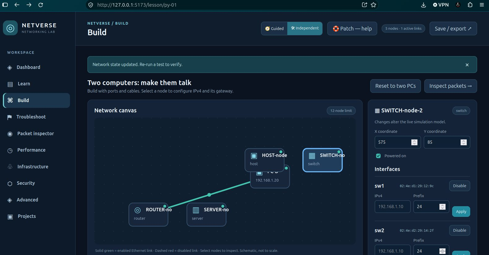
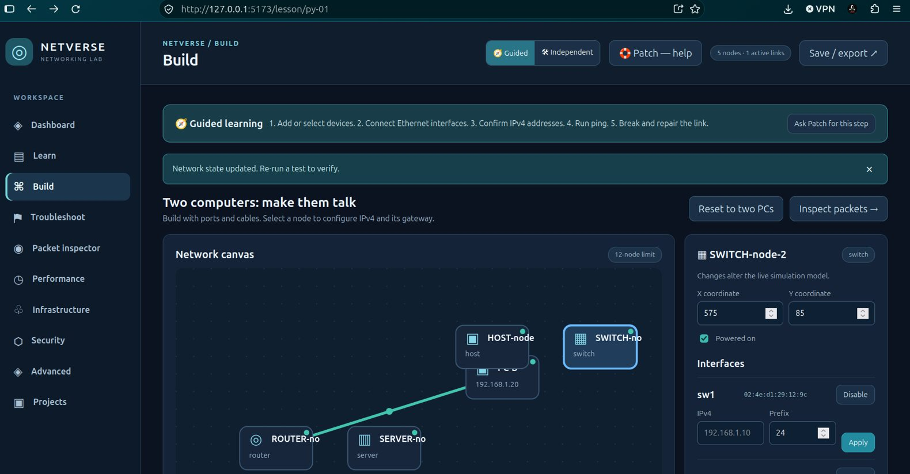
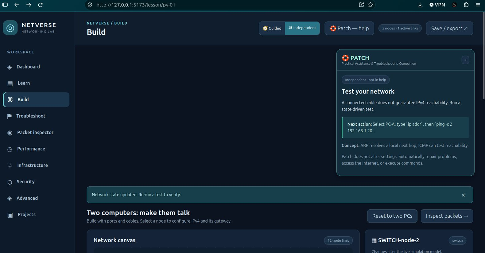
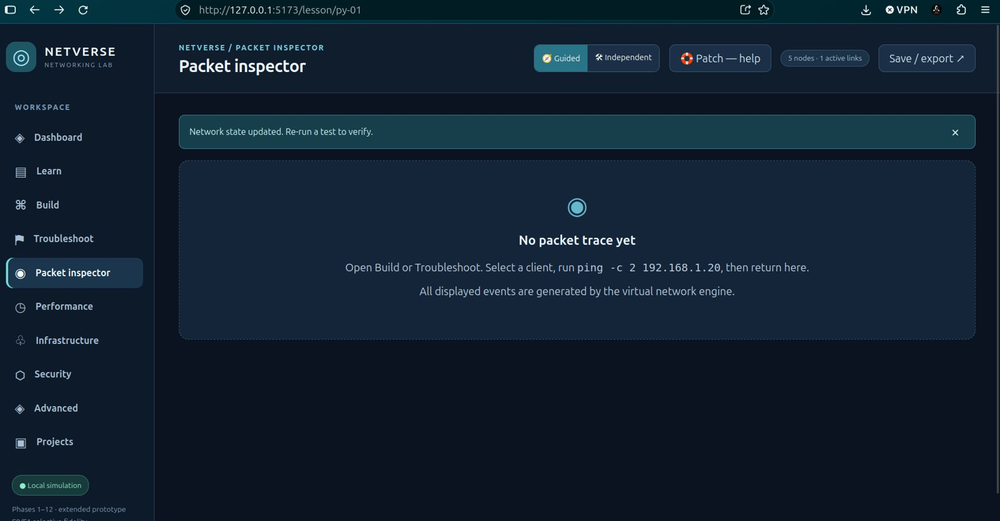
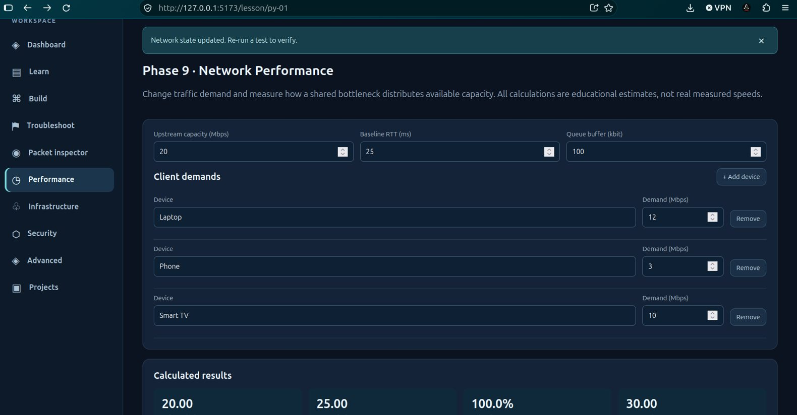
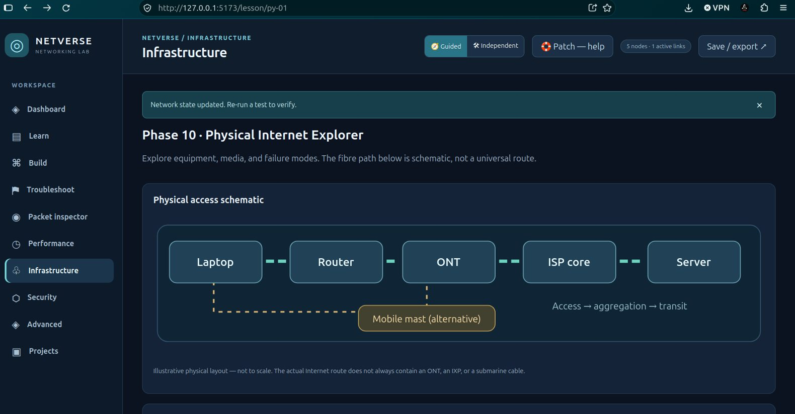
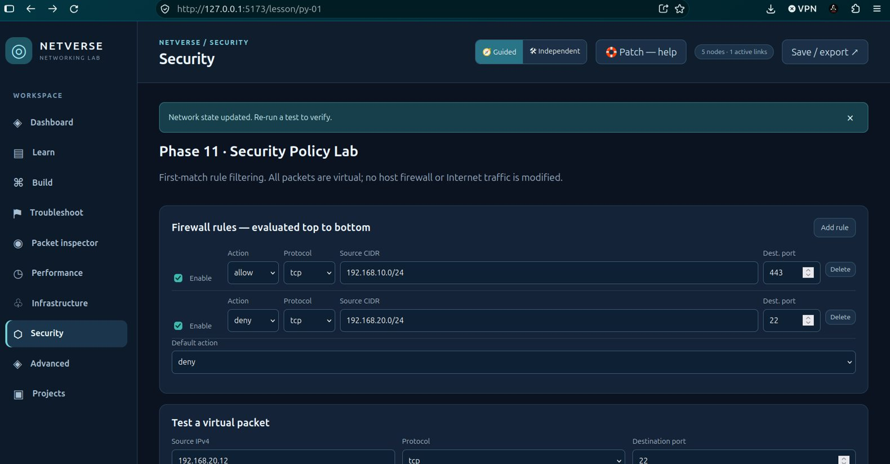

# NETVERSE LAB — User Manual

**Edition:** Extended educational release, Phases 1–14 candidate accepted in the owner's Ubuntu checks  
**Documentation date:** 27 October 2026  
**Platform:** Local-first web application (React, TypeScript, Vite)  
**Audience:** Learners, instructors, and anyone practising foundational networking

> **What this application is:** NETVERSE is a simulated networking classroom and laboratory. The virtual terminal, virtual hosts, router, switch, packets and incident cases do **not** operate on your real Wi-Fi, Ethernet router or the public Internet. Some newer laboratories are standalone conceptual models. The optional Linux namespace lab is different: it creates temporary **real** namespaces when you explicitly authorize it.

## Contents

1. [Installation from GitHub](#1-installation-from-github)
2. [Run or update NETVERSE](#2-run-or-update-netverse)
3. [Interface and learning modes](#3-interface-and-learning-modes)
4. [Learning using the nine-step method](#4-learning-using-the-nine-step-method)
5. [Build your first working network](#5-build-your-first-working-network)
6. [Device controls and virtual terminal](#6-device-controls-and-virtual-terminal)
7. [Packet Inspector](#7-packet-inspector)
8. [Troubleshooting missions](#8-troubleshooting-missions)
9. [Performance, infrastructure, security and advanced experiments](#9-performance-infrastructure-security-and-advanced-experiments)
10. [Projects, backups and privacy](#10-projects-backups-and-privacy)
11. [Optional real Linux namespace lab](#11-optional-real-linux-namespace-lab)
12. [Troubleshooting NETVERSE itself](#12-troubleshooting-netverse-itself)
13. [Simulation accuracy and known limitations](#13-simulation-accuracy-and-known-limitations)
14. [Hands-on practice route](#14-hands-on-practice-route)

---

## 1. Installation from GitHub

### 1.1 Prerequisites

You need a computer with Node.js, npm and Git installed. The development/release baseline was verified on Ubuntu with **Node.js v24.21.0**, **npm 11.19.0**, **Vite 8.3.5**, and **Vitest 5.0.5**. These are tested versions, **not a guarantee** that every different version will work. Use a currently supported Node.js version compatible with the repository's `package.json` and Vite requirements. A modern Firefox or Chromium-based browser is required.

On Ubuntu check:

```bash
node --version
npm --version
git --version
```

If a command is missing, install it using an official source suitable for your Ubuntu release. Don't install or execute random third-party scripts just to make NETVERSE run. An Internet connection is needed for the initial Git clone and dependency download; the local educational application does not need the public Internet while it runs.

### 1.2 Clone the published repository

After the maintainer publishes it, open the repository on GitHub, select **Code → HTTPS**, and copy the actual clone URL. Substitute that URL below; the example is a **proposed repository name**, not a claim that it already exists.

```bash
cd ~/Documents
git clone https://github.com/derrenderrick00-ux/netverse-lab.git
cd netverse-lab
```

For a private repository, you must already have access. Authentication may require a browser login or a personal access token managed by Git Credential Manager. Never paste credentials into NETVERSE's simulated terminal.

**Already have a local copy?** Do **not** clone over it or run `npm create vite` again. Work within the existing `~/Documents/netverse-lab` folder.

### 1.3 Install dependencies

```bash
npm ci
```

Use `npm ci` for a clean, reproducible install from `package-lock.json`. If it reports an incompatible Node version, correct the Node installation rather than deleting the lockfile. If the repository lacks a lockfile (not expected in this release), contact the maintainer rather than improvising a dependency upgrade.

### 1.4 Confirm it works

```bash
npm run lint
npm run build
npm test
```

Successful commands return exit code 0. On the maintainer's verified build the linter reported **0 errors / 0 warnings**, Vite built successfully, and **62 tests passed**. The precise test count may change in later releases; any failing test requires investigation.

### 1.5 Run locally

```bash
npm run dev -- --host 127.0.0.1
```

Open the URL displayed in the terminal, normally `http://127.0.0.1:5173/`. Keep the Terminal open while using NETVERSE. Press **Ctrl+C** to stop the development server.

> `127.0.0.1` means the server accepts connections only from your computer. Avoid `--host 0.0.0.0` on untrusted networks: that makes the development server accessible to other devices on your network.

### 1.6 Windows installation (optional)

In PowerShell, after installing Node.js and Git:

```powershell
cd "$HOME\Documents"
git clone <ACTUAL_GITHUB_CLONE_URL>
cd netverse-lab
npm ci
npm run dev -- --host 127.0.0.1
```

Replace `<ACTUAL_GITHUB_CLONE_URL>` with the URL from GitHub (without angle brackets). The Linux namespace experiment does **not** run natively on Windows. Android can use a compatible browser to view a reachable deployed build, but hosting the Vite development environment on Android is not a tested installation method.

---

## 2. Run or update NETVERSE

**Start a previously installed local copy:**

```bash
cd ~/Documents/netverse-lab
npm run dev -- --host 127.0.0.1
```

**Update a clean, published `main` checkout:**

```bash
cd ~/Documents/netverse-lab
git status
git pull --ff-only origin main
npm ci
npm run lint && npm run build && npm test
```

Before upgrading, open **Projects → Export JSON** and save your current network, especially if switching browser profiles or reinstalling the OS. Lesson progress resides in your browser, not GitHub. **Do not pull while you have uncommitted source edits**: commit or back them up first.

---

## 3. Interface and learning modes

The sidebar currently offers **Dashboard, Learn, Build, Troubleshoot, Packet inspector, Performance, Infrastructure, Security, Advanced, and Projects**. The Build workspace displays a network canvas, device inspector, patch panel (for Ethernet cables) and a separate simulated terminal.


*Figure 1 — Build workspace, with configurable nodes and the device inspector.*

### Guided mode

Select **🧭 Guided** in the header. Build and Troubleshoot show a short coaching strip describing the next actions. This is useful when you are learning unfamiliar concepts or need to know which controls to use.


*Figure 2 — Guided mode shows the build process.*

### Independent mode

Select **🛠 Independent**. The coaching strip disappears, but all tools and controls remain accessible. Use this when you want to solve a task without following prescribed instructions.

The choice is stored in the browser and should survive a reload when local storage is available. Switching modes does not automatically modify your topology or repair a fault.

### 🛟 Patch — Practical Assistance & Troubleshooting Companion

Select **Patch — help** at any time. Patch explains relevant concepts and suggests the next action for the current page. During incidents, a stronger hint is available on request.


*Figure 3 — Patch provides contextual, opt-in assistance.*

**Patch is not an online AI chatbot.** It is an offline rules-based coach. It does not run terminal commands, alter configurations, connect to real equipment or contact an ISP. In Independent mode, hints are voluntary.

---

## 4. Learning using the nine-step method

Open **Learn**, select a Module 01 lesson and proceed through the nine steps:

| Step | Learning activity |
|---|---|
| 1 | Topic and objectives |
| 2 | Terminology |
| 3 | Step-by-step explanation |
| 4 | Illustrations and diagrams |
| 5 | Code or command examples |
| 6 | Real-life applications |
| 7 | Exercises |
| 8 | Topic mini-project |
| 9 | Integrated main project |

Use **Previous** and **Next step** to navigate. Complete the knowledge check when it unlocks. A correct answer marks that implemented lesson complete. NETVERSE currently includes **three complete introductory lessons**; the other 13 curriculum modules are planned placeholders. Completing a lesson does not imply that the entire 14-module textbook has been implemented inside the app.

**Analogy:** Theory is the instruction manual for a piece of machinery; Build is the workshop where you assemble it; Troubleshoot is the service call when it fails. You need all three to become proficient.

---

## 5. Build your first working network

### Goal and starting state

Create an Ethernet connection between two PCs and prove they can exchange ICMP packets. Use **Build → Reset to two PCs** to restore the learning fixture. **This replaces the current topology**, so export it first if you want a separate backup.

Initial devices:

```text
PC-A eth0 — 192.168.1.10/24
PC-B eth0 — 192.168.1.20/24
Initially: no cable between the computers.
```

### Exercise A — Connect the devices

1. In **Build**, scroll to **Patch panel — Ethernet connections**.
2. Choose endpoint **PC-A: eth0**.
3. Choose endpoint **PC-B: eth0**.
4. Select **Connect**.
5. Verify the canvas shows an enabled (green) link.

There is currently a limit of **12 devices and 24 links**. Each Ethernet interface accepts one direct cable; switches have four independent ports. The canvas uses a schematic view. If symbols overlap after adding several nodes, use their **X/Y coordinate controls** in the device inspector.

### Exercise B — Verify IP addressing

Select **PC-A**, find its interface settings, and confirm `192.168.1.10/24`. Select **PC-B** and confirm `192.168.1.20/24`. Both addresses are in the same `/24` network.

### Exercise C — Ping from PC-A

Select **PC-A** as the terminal source and run:

```text
ip addr
ping -c 2 192.168.1.20
```

The ping summary should include **2 packets transmitted, 2 received**, assuming neither interface nor the cable was disabled. These commands are entered **inside NETVERSE's simulated terminal**, not Ubuntu Terminal.

### Exercise D — Break and repair

1. In the Build patch panel, find the link and choose **Disable**.
2. Re-run `ping -c 2 192.168.1.20`. Expect **0 received**.
3. Choose **Enable** for that link, then ping again. Expect **2 received**.
4. Open **Packet inspector** and inspect the new events.

**Explanation:** Two correct IP addresses do not guarantee connectivity when the physical/data-link path is missing.

### Exercise E — Explore a routed network

Load **Troubleshoot → Case 03 — Missing default gateway**. The incident provides a PC (`192.168.10.10`), a router (`192.168.10.1` and `192.168.20.1`) and a server (`192.168.20.20`). Use the router's interfaces and the PCs' default-gateway fields to understand how a packet crosses two networks. This model requires a valid **return path**, not merely an outgoing route.

---

## 6. Device controls and virtual terminal

### Device inspector

Select a node on the canvas (or from the accessible device list). Available controls include **Power on/off**, interface **Enable/Disable**, IPv4 address/prefix, router/host **Default gateway**, and X/Y coordinates. Apply validated IPv4 changes using the **Apply** button. The current model supports **hosts, servers, routers and four-port switches**; these are simplified educational devices.

The terminal processes commands against the **selected simulated PC, server or router**. It does **not** have access to your real shell.

| Supported command | Simulated purpose |
|---|---|
| `help` | Print the allowed commands |
| `clear` | Clear virtual terminal history |
| `ip addr` or `ip a` | Show assigned IPv4 addresses and MAC addresses |
| `ip link` | Show interface up/down state |
| `ip route` or `ip r` | Show connected/default IPv4 routes |
| `ip neigh` or `arp -a` | Show neighbors from the last relevant trace |
| `ping 192.168.1.20` | Run a simulated three-probe ping |
| `ping -c 2 192.168.1.20` | Ping with a count of 2 (allowed: 1–5) |
| `traceroute 192.168.1.20` | Simplified route description; not real TTL probes |

The **virtual terminal does not support** `sudo`, `apt`, `ssh`, `curl`, `dig`, full Linux networking commands, arbitrary shell execution, or live external Internet probes. Unsupported commands provide a limitation message.

**Common mistakes:** Select a **PC/server/router** before running commands (switches are not terminal sources). For ping use an IPv4 literal. Verify your source device's address, subnet, link status and gateway before suspecting routing.

---

## 7. Packet Inspector


*Figure 4 — Before your first ping the inspector correctly says there is no trace.*

After running a simulated ping, select **Packet inspector**. The event list is produced from the topology and the virtual command. Use **Next**, **Previous**, **Play/Pause** and replay controls to study the steps. A successful direct exchange may include **ARP request**, **ARP reply**, **ICMP Echo Request** and **Echo Reply** events.

The event timestamps are synthetic and deterministic. The simplified switch and traceroute models are not protocol-conformance tools. Running a new ping replaces the trace with the new result.

---

## 8. Troubleshooting missions

Open **Troubleshoot** and choose one of three tickets:

| Case | Fault introduced | Evidence and repair focus |
|---|---|---|
| 01 — Disconnected cable | An installed cable is disabled | Check the link; verify before and after |
| 02 — Wrong subnet | PC-B has incompatible IPv4 configuration | Compare addresses/prefixes and restore connectivity |
| 03 — Missing gateway | PC-A lacks a usable default route | Inspect routes; configure the correct gateway |

**Recommended workflow:** (1) Read the ticket, (2) run a failing baseline test, (3) inspect `ip addr`, `ip route` and links, (4) record evidence, (5) open Build to repair, (6) return and verify with ping, (7) explain your diagnosis and submit.

The score totals 100: successful repair+verification (40), observing an actual failed test (20), evidence text of at least 15 characters (20), and diagnosis text of at least 15 characters (20). **Important limitation:** the program checks the presence/length of evidence and explanation, not the semantic accuracy of your written diagnosis. Instructors should review explanations manually.

Loading an incident replaces the active network workspace. Export the current network first if you need to keep a separate project.

---

## 9. Performance, infrastructure, security and advanced experiments

### Performance — Internet speed and shared bandwidth


*Figure 5 — Adjust demand, upstream capacity, baseline RTT and queue buffer.*

Open **Performance**. Set **Upstream capacity (Mbps)** and each client's **Demand (Mbps)**. The results represent a simplified **one-bottleneck max-min fair allocation**, not an actual speed test. For 20 Mbps capacity and two 20 Mbps demands, each receives approximately **10 Mbps**. With demands 2 and 20 Mbps, results should be **2 and 18 Mbps**.

**Useful analogy:** A single 20-litre-per-minute pipe feeds multiple taps. Idle taps don't automatically consume water, and one lightly used tap leaves capacity for another. Internet sharing is more complex, but the analogy explains why device count alone does not determine speed.

The display distinguishes **unmet demand** from measured packet loss. Actual throughput also depends on Wi-Fi airtime, radio interference, protocol overhead, device capability and congestion control—these are not fully implemented.

### Infrastructure — Explore physical Internet components


*Figure 6 — One schematic path; real networks have different topologies.*

Select objects including **ONT, optical fibre, OLT, Internet exchange equipment and mobile mast**. The inspector describes role, upstream/downstream relationships, medium, a typical failure, and an everyday analogy. These are interactive explanations, **not** an optical-physics simulation or full 3D scene.

### Security — First-match firewall rules


*Figure 7 — Ordered virtual firewall policy exercise.*

Set a virtual packet's source IPv4, protocol and destination port. Rules are evaluated **top to bottom**; the first matching enabled rule decides. Any unmatched valid flow uses the configured default action.

Try `192.168.10.12` + TCP + port `443`: the provided office rule allows it. Try `192.168.20.12` + TCP + port `22`: the guest SSH rule denies it. Change the order or disable a rule to observe policy effects. **These firewall rules do not apply to the Build simulator or your Ubuntu firewall.**

### Advanced — VLAN, TCP and IPv6

The **Advanced** tab contains three independent exercises:

- **VLAN membership:** Check whether two enabled simulated access ports share a VLAN. Not 802.1Q frame forwarding.
- **TCP handshake:** Toggle delivery of SYN, SYN-ACK and ACK to see a simplified establishment sequence. Not real sockets or retransmissions.
- **IPv6 prefix comparison:** Compare hexadecimal IPv6 addresses with a `/0`–`/128` prefix. Not IPv6 traffic forwarding or NDP; IPv4-embedded forms and scope suffixes are intentionally unsupported.

---

## 10. Projects, backups and privacy

NETVERSE stores the **active network** and introductory **lesson progress** in the current browser's `localStorage`. The learning-mode preference is also stored locally. A different browser/profile, private browsing session or cleared site data may not preserve them.

To back up your topology:

1. Open **Projects**.
2. Set a recognizable project title.
3. Choose **Save now**, then **Export JSON**.
4. Keep `netverse-project.json` somewhere safe.

To restore it, use **Import NETVERSE JSON** and select the saved file. Imports must follow project **schema version 1**, pass device/port/link validation and be no larger than **250 KB**. Malformed input should be rejected rather than executed. JSON export is a **topology backup**; it is **not a full export of lesson progress, incident notebooks, or preferences**.

**Privacy:** Do not enter real router passwords, ISP credentials or private company topology secrets. Local browser storage is not encrypted secure storage.

---

## 11. Optional real Linux namespace lab

This experiment is **not part of the browser simulator**. It creates isolated Linux network namespaces and a veth pair using actual kernel networking. Review the script and obtain permission before using it on a managed/shared computer.

Preview requirements without making changes:

```bash
cd ~/Documents/netverse-lab
bash scripts/real_linux_namespace_lab.sh
```

Only if you understand and authorize the temporary namespace changes:

```bash
sudo bash scripts/real_linux_namespace_lab.sh --run
```

The script creates two temporary namespaces, tests `192.0.2.10` → `192.0.2.20`, disables the peer interface to demonstrate failure, restores it and removes the namespaces on exit. It deliberately avoids changing host-wide NAT, DNS, default routes, firewall or forwarding. It requires Linux, `iproute2`, suitable privileges and namespace support. **Never run it against networks or systems you do not control or have authorization to manage.**

If it fails, inspect the output and check for residual test namespaces using `ip netns list`; do not indiscriminately delete unrelated namespaces.

---

## 12. Troubleshooting NETVERSE itself

| Symptom | Check / corrective action |
|---|---|
| `git clone` fails | Check actual repository URL, connectivity and GitHub permissions |
| `npm ci` fails | Verify Node/npm versions; keep the lockfile; retry on a working connection |
| `vite: command not found` | Run `npm ci` inside the cloned folder; use `npm run dev` |
| `localhost:5173` unreachable | Keep Vite running, use displayed port, verify browser isn't opening the wrong profile or proxy |
| Build command fails | Run `npm run build`, record TypeScript errors; don't disable type safety to hide them |
| Test fails | Run `npm test`; capture the failing test and source commit |
| No packet trace | Select a non-switch source and run a simulated `ping` in Build or Troubleshoot |
| Ping fails unexpectedly | Inspect cable, port state, addresses, prefixes, default gateway and return path |
| Nodes overlap | Select device and edit X/Y coordinates; canvas placement is schematic |
| Import rejected | Check JSON schema/version and 250 KB file-size limit |
| Progress missing | Check browser profile and site storage; topology JSON doesn't restore lessons |
| Patch not showing | Use **Patch — help** in the header and check if its panel is open above the main workspace |
| Security policy doesn't affect ping | By design: Security is a separate conceptual sandbox |

**Known UI issue worth improving:** the current application uses sidebar-managed internal section state, not a fully synchronized route-based page system; a pre-existing browser URL path can remain visible while the selected sidebar section changes. This does **not** mean the visible network lab itself is executing the wrong page, but share the URL/screenshot when reporting a navigation bug.

---

## 13. Simulation accuracy and known limitations

NETVERSE currently implements a focused educational model. The core supports **state-based IPv4, directly connected routes, one default gateway, basic router forwarding, simplified switching, ARP and ICMP**. It does **not** implement real Wi-Fi radio behavior, DHCP, DNS, NAT, BGP, IPv6 forwarding, production TCP congestion control, full Ethernet broadcast/aging/STP, or real external Internet access.

The other laboratories are separate, intentionally simplified learning models. The Phase 13 script is the only provided option that creates actual Linux network interfaces, and it runs only when invoked with elevated permissions. NETVERSE is **not** a substitute for Wireshark, Cisco Packet Tracer, GNS3, or authorized real-hardware practice.

For technical assumptions, see [ENGINE_FIDELITY.md](ENGINE_FIDELITY.md), [DEVELOPER_MANUAL.md](DEVELOPER_MANUAL.md), and [PHASES_9_14_ACCEPTANCE.md](PHASES_9_14_ACCEPTANCE.md).

---

## 14. Hands-on practice route

**Session 1 (30 min):** Study one introductory lesson; use Patch if needed.  
**Session 2 (30 min):** Connect two PCs, inspect `ip addr`, then ping.  
**Session 3 (30 min):** Disable/re-enable a link; inspect the ARP/ICMP trace.  
**Session 4 (30 min):** Solve Case 01 in Independent mode; write evidence.  
**Session 5 (30 min):** Solve wrong-subnet and gateway cases.  
**Session 6 (30 min):** Compare bandwidth demand and capacity.  
**Session 7 (30 min):** Explore fibre/ONT/OLT/ISP equipment and security policy.  
**Session 8 (30 min):** Export a project, import it, and explain what NETVERSE can and cannot simulate.

**Learning outcome:** Don't just obtain a green status. Explain *which layer*, *which device*, *which observation* and *which correction* justified your conclusion.
